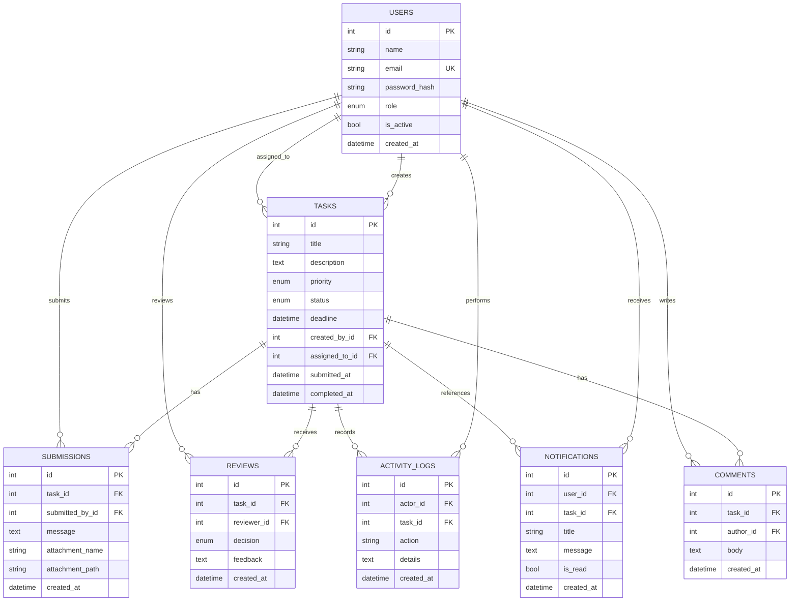

# Database schema / ERD

## Workflow status values

`assigned`, `in_progress`, `submitted`, `revision_requested`, `approved`, `rejected`.

Review decision values: `approved`, `rejected`, `revision_requested`.
